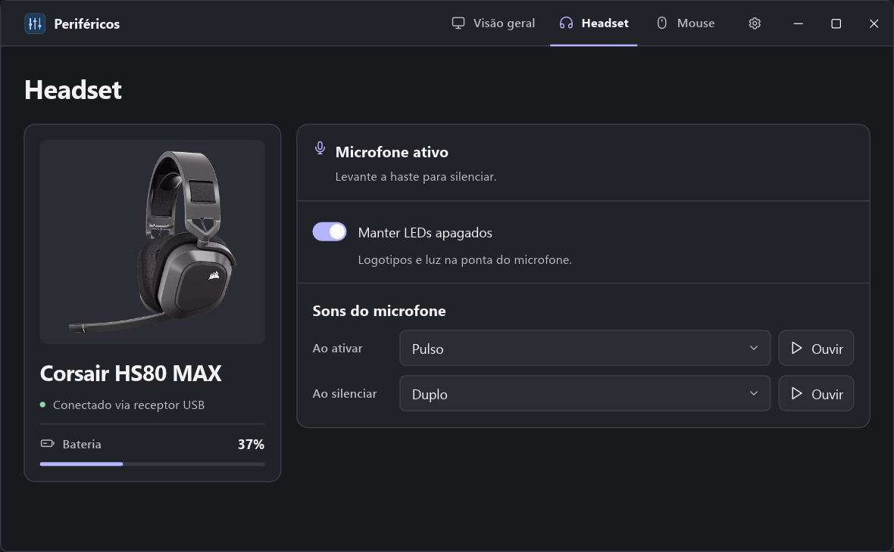
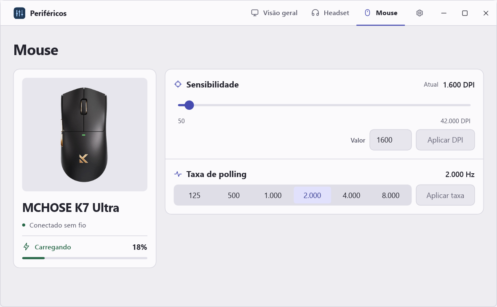

# Periféricos

Controle o microfone e os LEDs do seu headset, ajuste o DPI e a taxa de polling do mouse e acompanhe a bateria dos dois perto do relógio do Windows.

[Baixar para Windows x64](https://github.com/omarcosr/perifericos/releases/latest) · [Dispositivos compatíveis](#dispositivos-compatíveis) · [Desenvolvimento](#desenvolvimento)

| Headset · tema escuro | Mouse · tema claro |
| --- | --- |
|  |  |

## Começar

1. Baixe o `Perifericos-Setup-<versão>-win32-x64.exe` na seção **Assets** da release mais recente.
2. Execute o instalador e abra **Periféricos** pelo menu Iniciar. A instalação é por usuário e pode ser removida em **Configurações do Windows → Aplicativos → Aplicativos instalados**.
3. Conecte o receptor do headset ou o mouse compatível e selecione **Headset** ou **Mouse** no painel.

Se você compilou o projeto localmente, abra `dist/Perifericos.exe`.

A porcentagem do headset aparece em **azul** na bandeja do sistema e a do mouse selecionado, em **verde**. Passe o cursor sobre o indicador para conferir o estado de carga. Se os ícones estiverem no menu oculto **^**, arraste-os para perto do relógio.

Para manter o controle em segundo plano ao entrar na conta, abra **Configurações** pela engrenagem ou pelo menu da bandeja e ative **Iniciar com o Windows**. O app abre na bandeja cerca de 15 segundos após o login. Se a versão portátil já iniciava com o Windows, o instalador transfere essa configuração para o app instalado.

## Dispositivos compatíveis

| Dispositivo | Conexão | Controles |
| --- | --- | --- |
| **Corsair HS80 MAX** | Receptor USB de 2,4 GHz | Bateria, estado de carga, LEDs dos logotipos e da ponta do microfone, mudo pela haste e sons ao ativar e silenciar. |
| **Razer Viper V3 Pro** | Cabo USB ou receptor de 2,4 GHz | Conexão, bateria, estado de carga, DPI e taxa de polling. |
| **MCHOSE K7 Ultra original** | Cabo USB ou receptor de 2,4 GHz | Conexão, bateria, estado de carga, DPI e taxa de polling. |

**Headset.** Feche o iCUE para liberar o controle do HS80 MAX. Se estiver migrando do controlador antigo em C/CUI, encerre-o pela bandeja e desative a inicialização dele antes de ativar a do Periféricos.

**Mouse.** Se os dois modelos estiverem conectados, use o seletor **Dispositivo**. Ajuste a sensibilidade pelo slider ou pelo campo numérico e confirme em **Aplicar DPI**. Para mudar o polling, escolha a frequência e clique em **Aplicar taxa**. O painel relê os valores do mouse após cada ajuste.

## Atualizações

O app consulta as releases públicas do GitHub ao iniciar e a cada seis horas. Quando encontra uma versão mais recente, exibe um ícone de download na barra de título e a opção **Atualização disponível** na bandeja. Abra o popup e clique em **Instalar e reiniciar** para acompanhar o download.

O atualizador verifica a assinatura do manifesto e o SHA-256 do arquivo. Quando o runtime é compatível, baixa apenas o pacote incremental. Atualizações que exigem uma base diferente baixam o executável completo.

Se você usa a versão 0.5.4 ou anterior, execute o instalador da versão atual uma vez para voltar a receber atualizações pelo app. [Release mais recente](https://github.com/omarcosr/perifericos/releases/latest)

## Desenvolvimento

O painel usa TypeScript, TSX e Tarve. A versão distribuída usa txiki.js com QuickJS-ng. A comunicação com os dispositivos e o microfone passa pelas APIs HID e Core Audio do Windows.

Com Bun instalado no Windows x64, execute os comandos abaixo na raiz do projeto.

```powershell
bun install --frozen-lockfile
bun run check
bun run test
bun run dev
```

Para gerar `dist/Perifericos.exe`, instale também o txiki.js 26.6.0 e deixe o `tjs` no PATH ou aponte `TARVE_TXIKI` para o executável. O build usa a chave de assinatura configurada na seção seguinte.

```powershell
bun run build
```

<details>
<summary>Testes visuais, argumentos e referências do código</summary>

O teste visual usa dados simulados e salva uma imagem do painel e as coordenadas dos controles.

```powershell
bun tests/panel.visual.tsx headset dark normal
bun tests/panel.visual.tsx updates light compact
```

O modo `bun run dev:node` usa Node.js 26.10 ou posterior com FFI experimental.

| Argumento | Efeito |
| --- | --- |
| `--run` | Inicia na bandeja. |
| `--mouse` | Abre o painel na aba Mouse. |
| `--updates` | Abre o popup de atualizações. |
| `--hide` | Oculta a janela da instância em execução. |
| `--stop` | Encerra o app. |

As preferências ficam em `%LOCALAPPDATA%\PerifericosTarve\preferencias.ini`. Antes da primeira execução, `PERIFERICOS_IMPORT_INI` pode apontar para o `hs80.ini` do controlador em C/CUI e importar os ajustes de LEDs e sons.

O [catálogo HID](src/devices/catalog.ts) concentra os modelos e as interfaces reconhecidas. O K7 Ultra original usa `3837:1001` no receptor e `3837:4150` no cabo. A leitura foi testada nos dois modos com firmware 5.28.5.0. [Referência do protocolo do K7 Ultra](https://github.com/aipno/mchose-linux/blob/main/docs/PROTOCOL.md)

</details>

## Publicação

Altere `version` no `package.json` e envie a mudança à `main`. O workflow **Publicar versão** roda os testes e envia o instalador, o executável, o pacote `.tarve` e o manifesto assinado `latest.json` à release antes de publicá-la. [Workflow de publicação](.github/workflows/release.yml)

Para publicar a versão atual, abra **Actions → Publicar versão → Run workflow** e escolha a `main`. Se um envio parar no meio, reexecute o workflow do commit original para concluir o rascunho.

<details>
<summary>Configurar a assinatura e gerar uma release local</summary>

O workflow precisa do secret `TARVE_UPDATE_PRIVATE_KEY` com a chave privada correspondente à chave pública do app. Cadastre-o uma vez na máquina que guarda a chave, com o GitHub CLI autenticado.

```powershell
$keyPath = Join-Path $env:LOCALAPPDATA 'PerifericosTarve\assinatura\tarve-update.key'
Get-Content -LiteralPath $keyPath -Raw | gh secret set TARVE_UPDATE_PRIVATE_KEY --repo omarcosr/perifericos
```

Guarde a chave privada fora do Git e reutilize-a nas próximas versões para que os apps instalados aceitem as atualizações. A consulta do app usa o endereço público das releases do repositório. [Secrets do GitHub Actions](https://docs.github.com/en/actions/how-tos/write-workflows/choose-what-workflows-do/use-secrets)

Para gerar os arquivos em `releases/<versão>`, use a chave no caminho acima ou informe seu caminho ou valor em base64 na variável `TARVE_UPDATE_PRIVATE_KEY`. O instalador é gerado pelo próprio Tarve (`tarve package --format setup`) a partir do campo `tarve.installer` do `package.json`; não precisa de ferramentas externas. Para usar um checkout do Tarve, aponte `TARVE_CLI` para `packages/core/cli.ts`.

```powershell
bun run release --notes 'Resumo da versão'
```

Para testar com outro servidor, defina `PERIFERICOS_UPDATE_URL` com o endereço do manifesto. Sirva os arquivos no mesmo diretório ou informe o endereço dos artefatos com `--base-url` ao gerar a release.

</details>

Imagens dos dispositivos fornecidas pelos fabricantes. [Corsair](https://www.corsair.com/us/en/p/gaming-headsets/ca-9011295-na/hs80-max-wireless-gaming-headset-steel-gray-ca-9011295-na) · [Razer](https://www.razer.com/gaming-mice/razer-viper-v3-pro/RZ01-05120100-R3U1) · [MCHOSE](https://www.mchose.store/products/mchose-k7-ultra-lightweight-wireless-gaming-mouse)
